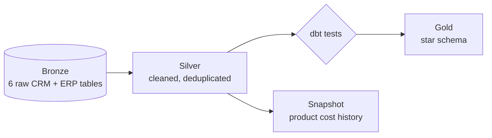

<p align="center"></p>

A data warehouse built from scratch with **dbt**, to understand the whole journey data takes: raw CRM and ERP tables come in, get cleaned in layers, and end up as a star schema ready for reports.

## How the data flows



| Layer | What it holds | Models |
|---|---|---|
| **Bronze** | Raw data as it arrives (schema `kente_bronze`) | `crm_cust_info`, `crm_prd_info`, `crm_sales_details`, `erp_cust_az12`, `erp_loc_a101`, `erp_px_cat_g1v2` |
| **Silver** | Cleaned and checked: trimmed text, standardised codes, one latest record per customer | `slv_crm_*`, `slv_erp_*` |
| **Gold** | Ready for reports: a star schema with surrogate keys | `dim_customers`, `dim_products`, `fact_sales` |

## What's worth a look

- **Incremental fact table.** `fact_sales` only loads orders newer than what it already has, and fails loudly if the schema changes.
- **Price history.** A dbt snapshot (`snap_prd_cost`) keeps every change to a product's cost, so past sales can be read at the cost that applied then.
- **Quality gates.** Tests on the silver layer (`unique`, `not_null` on customer ids) run before gold is built. If a check fails, the pipeline stops and bad numbers never reach a report.
- **CRM and ERP joined.** Customer and product dimensions combine both source systems.

## Run it

Requires dbt with the MySQL adapter (`dbt-core 1.7`, `dbt-mysql 1.7`) and a profile named `kente_dw`.

```bash
dbt run --select silver
dbt test --select silver
dbt snapshot
dbt run --select gold
dbt test --select gold
```

This sequence is scheduled daily by Airflow in [airflow-kente](https://github.com/kente001/airflow-kente).

---

<sub>Part of <b>the silent data</b> · Kennedy Njoroge</sub>
